# Section Dependency Graph

Which section projects reference which, read from the `<ProjectReference>` items in
`src/Sections/*/*.csproj`. One node per section; a `Humans.<X>.Contracts` project folds
into section X.

- Solid arrow (`-->`): the section references the other section's implementation project.
- Dashed arrow (`-.->`): it references only the other section's `.Contracts` project.
- Not drawn: `Humans.Base` (every section references it) and `Humans.Web` (the Shell
  references every section).

The block below is generated. Do not edit it by hand; run
`bash docs/scripts/generate-dependency-graph.sh`.

```mermaid
graph LR
    Agent
    AuditLog
    Auth
    Backdoor
    Budget
    Calendar
    Campaigns
    Camps
    Cantina
    CityPlanning
    Consent
    Containers
    Debug
    Development
    EarlyEntry
    Email
    Events
    Expenses
    Finance
    Gate
    Gdpr
    Google
    Governance
    Grants
    Guide
    Holded
    Issues
    LowIncome
    MailerLite
    Monitor
    Notifications
    Onboarding
    Pleo
    Preapprovals
    Rideshare
    Scanner
    Search
    Settings
    Shifts
    Store
    Stripe
    Surveys
    Teams
    TicketTailor
    Tickets
    Tour
    Users
    Workgroups
    Agent --> AuditLog
    Agent --> Auth
    Agent --> Consent
    Agent --> Issues
    Agent --> Settings
    Agent -.-> Governance
    Agent -.-> Shifts
    Agent -.-> Teams
    Agent -.-> Tickets
    Auth -.-> Email
    Auth -.-> Notifications
    Auth -.-> Teams
    Auth -.-> Users
    Backdoor --> Agent
    Backdoor --> Auth
    Backdoor --> Budget
    Backdoor --> Expenses
    Backdoor --> Holded
    Backdoor --> Issues
    Backdoor --> Store
    Backdoor --> Surveys
    Backdoor -.-> Finance
    Backdoor -.-> Notifications
    Budget --> Issues
    Budget -.-> Camps
    Budget -.-> Finance
    Budget -.-> Teams
    Budget -.-> Tickets
    Calendar --> AuditLog
    Calendar -.-> Teams
    Campaigns -.-> Email
    Campaigns -.-> Notifications
    Campaigns -.-> Teams
    Campaigns -.-> Tickets
    Campaigns -.-> Users
    Camps --> CityPlanning
    Camps --> EarlyEntry
    Camps --> Google
    Camps --> Issues
    Camps --> Settings
    Camps -.-> Email
    Camps -.-> Notifications
    Camps -.-> Shifts
    Camps -.-> Teams
    Camps -.-> Tickets
    Cantina --> Settings
    Cantina -.-> Shifts
    CityPlanning --> Containers
    CityPlanning --> Issues
    CityPlanning --> Settings
    CityPlanning -.-> Camps
    CityPlanning -.-> Teams
    Consent --> Auth
    Consent --> Issues
    Consent -.-> Email
    Consent -.-> Governance
    Consent -.-> Notifications
    Consent -.-> Onboarding
    Consent -.-> Teams
    Consent -.-> Users
    Containers -.-> Camps
    Containers -.-> CityPlanning
    Debug --> Consent
    Debug --> Settings
    Debug -.-> Email
    Debug -.-> Shifts
    Debug -.-> Tickets
    Development --> Auth
    Development --> Budget
    Development --> Consent
    Development --> Settings
    Development -.-> Camps
    Development -.-> CityPlanning
    Development -.-> Shifts
    Development -.-> Teams
    Development -.-> Users
    EarlyEntry -.-> Shifts
    Email --> Settings
    Email -.-> Users
    Events --> Calendar
    Events --> Camps
    Events --> Settings
    Events -.-> Email
    Expenses --> AuditLog
    Expenses --> Budget
    Expenses --> Holded
    Expenses --> Preapprovals
    Expenses -.-> Email
    Expenses -.-> Finance
    Expenses -.-> Teams
    Finance --> Budget
    Finance --> Expenses
    Finance --> Holded
    Finance --> Pleo
    Finance -.-> Email
    Finance -.-> Tickets
    Gate --> Auth
    Gate --> EarlyEntry
    Gate --> Settings
    Gate -.-> Shifts
    Gate -.-> Tickets
    Gdpr -.-> Users
    Google --> AuditLog
    Google --> Auth
    Google --> Settings
    Google -.-> Email
    Google -.-> Notifications
    Google -.-> Teams
    Google -.-> Users
    Governance --> Auth
    Governance --> Consent
    Governance --> Google
    Governance --> Issues
    Governance --> Onboarding
    Governance -.-> Email
    Governance -.-> Notifications
    Governance -.-> Teams
    Grants --> Settings
    Grants -.-> Email
    Grants -.-> Notifications
    Grants -.-> Users
    Guide --> Auth
    Guide -.-> Camps
    Guide -.-> Teams
    Holded -.-> Finance
    Issues --> AuditLog
    Issues --> Auth
    Issues -.-> Email
    Issues -.-> Notifications
    LowIncome --> Grants
    MailerLite -.-> Email
    MailerLite -.-> Shifts
    MailerLite -.-> Tickets
    MailerLite -.-> Users
    Monitor --> Google
    Monitor --> Settings
    Notifications --> Auth
    Notifications --> Consent
    Notifications --> Google
    Notifications -.-> Camps
    Notifications -.-> Email
    Notifications -.-> Governance
    Notifications -.-> Shifts
    Notifications -.-> Teams
    Notifications -.-> Tickets
    Onboarding --> Consent
    Onboarding --> Issues
    Onboarding --> Settings
    Onboarding -.-> Email
    Onboarding -.-> Governance
    Onboarding -.-> Notifications
    Onboarding -.-> Shifts
    Onboarding -.-> Teams
    Onboarding -.-> Users
    Pleo -.-> Finance
    Preapprovals -.-> Email
    Preapprovals -.-> Finance
    Preapprovals -.-> Notifications
    Rideshare --> Settings
    Rideshare -.-> Notifications
    Scanner --> Calendar
    Scanner --> Consent
    Scanner --> EarlyEntry
    Scanner --> Events
    Scanner --> Issues
    Scanner --> Settings
    Scanner --> Tickets
    Search --> Camps
    Search --> Events
    Search --> Shifts
    Search --> Teams
    Shifts --> Auth
    Shifts --> Calendar
    Shifts --> Cantina
    Shifts --> Consent
    Shifts --> EarlyEntry
    Shifts --> Issues
    Shifts --> Onboarding
    Shifts --> Settings
    Shifts --> Teams
    Shifts -.-> Camps
    Shifts -.-> Email
    Shifts -.-> Notifications
    Shifts -.-> Tickets
    Store --> AuditLog
    Store --> Holded
    Store --> Settings
    Store --> Stripe
    Store -.-> Camps
    Store -.-> Finance
    Store -.-> Teams
    Stripe -.-> Finance
    Surveys --> Google
    Surveys -.-> Email
    Surveys -.-> Governance
    Surveys -.-> Shifts
    Surveys -.-> Teams
    Surveys -.-> Tickets
    Teams --> AuditLog
    Teams --> Auth
    Teams --> Consent
    Teams --> EarlyEntry
    Teams --> Google
    Teams --> Issues
    Teams --> Settings
    Teams -.-> Camps
    Teams -.-> Email
    Teams -.-> Governance
    Teams -.-> Notifications
    Teams -.-> Shifts
    Teams -.-> Tickets
    TicketTailor --> Tickets
    Tickets --> AuditLog
    Tickets --> Auth
    Tickets --> Budget
    Tickets --> Campaigns
    Tickets --> Consent
    Tickets --> EarlyEntry
    Tickets --> Issues
    Tickets --> Settings
    Tickets --> Stripe
    Tickets -.-> Camps
    Tickets -.-> Email
    Tickets -.-> Finance
    Tickets -.-> Governance
    Tickets -.-> Teams
    Tickets -.-> Users
    Users --> AuditLog
    Users --> Auth
    Users --> Camps
    Users --> Cantina
    Users --> Consent
    Users --> Gdpr
    Users --> Google
    Users --> Issues
    Users --> Settings
    Users -.-> Email
    Users -.-> Governance
    Users -.-> Notifications
    Users -.-> Onboarding
    Users -.-> Shifts
    Users -.-> Teams
    Users -.-> Tickets
    Workgroups --> Auth
    Workgroups --> Calendar
    Workgroups --> Google
    Workgroups --> Holded
    Workgroups --> Settings
    Workgroups --> Surveys
    Workgroups -.-> Email
    Workgroups -.-> Finance
    Workgroups -.-> Governance
    Workgroups -.-> Notifications
    Workgroups -.-> Teams
```

<!-- BEGIN GENERATED: bash docs/scripts/generate-dependency-graph.sh -->

<!-- END GENERATED -->
